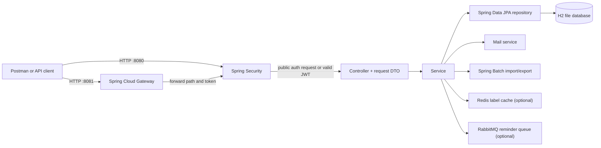
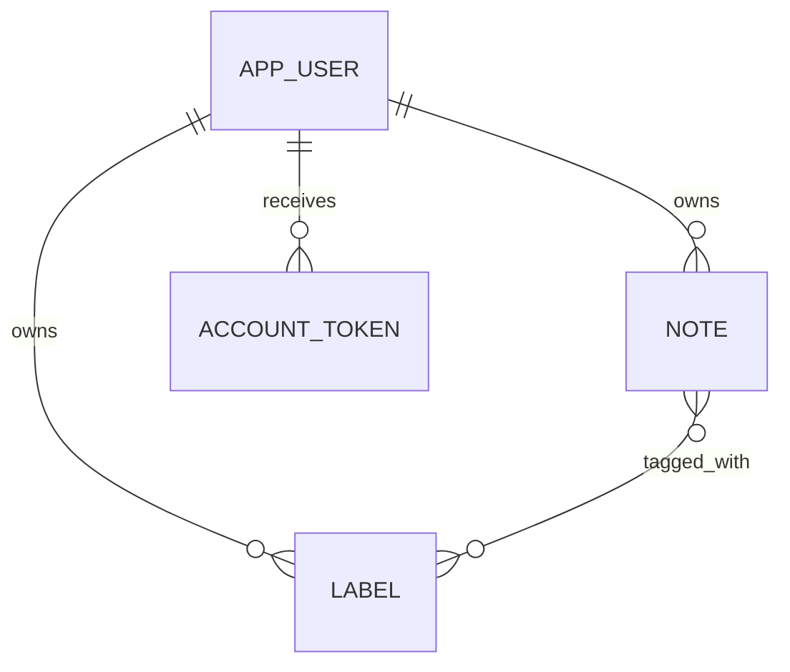
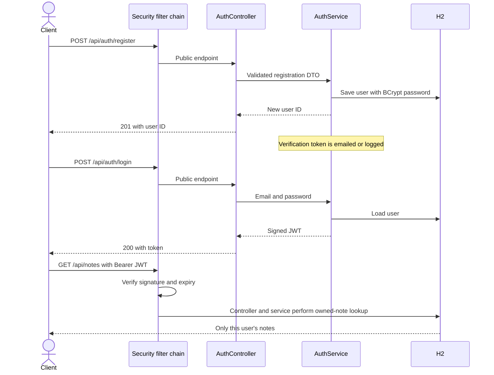
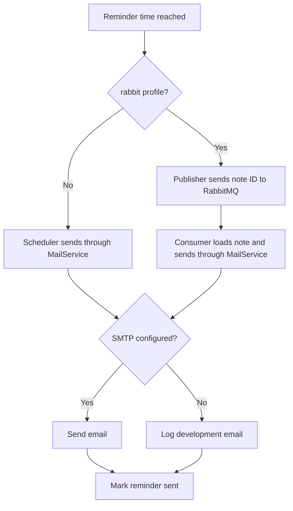
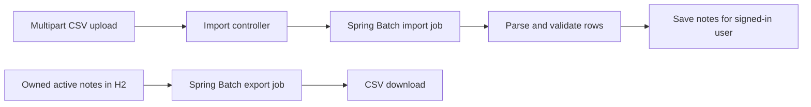

# Fundoo Notes

A Spring Boot backend for personal notes. The project follows small use cases so each feature can be studied on its own. Application code is on [develop](https://github.com/Mihir-Lakhani/Bridgelabz-Fundoo-Notes/tree/develop); `main` contains this guide only.

## At a glance

| Item | Details |
| --- | --- |
| Language | Java 21 |
| Backend | Spring Boot 4.1.2, Spring MVC, Spring Security |
| Database | H2 file database with Spring Data JPA |
| Authentication | BCrypt passwords and two-hour HS256 JWTs |
| Optional integrations | SMTP, Redis, RabbitMQ |
| Other features | Spring Batch CSV import/export, scheduled jobs, Spring AOP, Spring Cloud Gateway |
| Backend port | `8080` |
| Gateway port | `8081` |

## Use cases

Each rebuilt UC has its own `feature/uc-*` branch from `develop` and a non-fast-forward merge back into `develop`. The [earlier draft](https://github.com/Mihir-Lakhani/Bridgelabz-Fundoo-Notes/tree/archive/first-fundoo-draft) is kept separately.

| UC | Feature | What it adds | Status |
| --- | --- | --- | --- |
| 01 | Registration | Validate user details, reject duplicate email, hash password with BCrypt | Complete |
| 02 | Login and JWT | Authenticate credentials and issue a signed access token | Complete |
| 03 | Profile | Read and update the signed-in user's name | Complete |
| 04 | Account recovery | Email verification and one-use password reset tokens | Complete; SMTP optional |
| 05 | Notes CRUD | Create, list, read, update, and soft-delete owned notes | Complete |
| 06 | Note lifecycle | Pin, archive, trash, restore, and permanently delete | Complete |
| 07 | Search | Find active notes by title or description | Complete |
| 08 | Labels | Create/delete labels, attach/detach them, filter notes | Complete |
| 09 | Reminders | Set, view, and remove a reminder time | Complete |
| 10 | Reminder email | Check due reminders every minute and send email | Complete; SMTP optional |
| 11 | Redis | Cache each user's label list and evict on changes | Complete; `redis` profile |
| 12 | RabbitMQ | Queue due reminder IDs for an email consumer | Complete; `rabbit` profile |
| 13 | AOP | Log note-service activity and execution time | Complete |
| 14 | CSV import | Import notes from uploaded CSV through Spring Batch | Complete |
| 15 | Trash cleanup | Delete notes after the configured Trash retention period | Complete |
| 16 | CSV export | Export active notes through Spring Batch | Complete |
| 17 | API Gateway | Forward `/api/**` through a separate application | Complete |
| 18 | Integration checks | Test security, ownership, features, CSV, and gateway routing | Complete |

## How the application fits together





The gateway only routes requests. The backend verifies JWTs and checks note/label ownership. Controllers handle HTTP and DTOs; services hold the application logic; repositories access H2. The code uses packages `config`, `controller`, `dto`, `entity`, `exception`, `repository`, `service`, `batch`, and `aop`. No Lombok or mapper framework is required.

## Run locally

Requirements: Java 21 or newer and Maven, or IntelliJ IDEA's Maven tool window. No external database is required.

```bash
git switch develop
mvn spring-boot:run
```

The backend starts at `http://localhost:8080`. H2 stores data in the ignored local `data/` directory. To start the optional gateway, leave the backend running and use another terminal:

```bash
cd fundoo-api-gateway
mvn spring-boot:run
```

The gateway starts at `http://localhost:8081` and forwards `/api/**` to `http://localhost:8080`. Set `FUNDOO_BACKEND_URL` if the backend runs elsewhere.

Set `FUNDOO_JWT_SECRET` to a random secret of at least 32 characters for a stable signing key across restarts. Without it, startup generates a temporary random key and old tokens stop working after restart. For example, in PowerShell:

```powershell
$env:FUNDOO_JWT_SECRET = "replace-with-a-random-secret-of-at-least-32-characters"
mvn spring-boot:run
```

## Request flow



Public endpoints are the five `POST /api/auth/*` endpoints below. Every user, label, and note endpoint needs `Authorization: Bearer <token>`. A token expires two hours after login. Email verification is recorded, but login does not require it.

## API reference

### Account and profile

| Method | Path | Request | Result |
| --- | --- | --- | --- |
| POST | `/api/auth/register` | `{"name":"Mihir","email":"mihir@example.com","password":"password123"}` | `201` and new user ID |
| POST | `/api/auth/login` | Email and password | `200` and JWT token |
| POST | `/api/auth/verify` | `{"token":"..."}` | `204`; marks email verified |
| POST | `/api/auth/forgot-password` | `{"email":"mihir@example.com"}` | `202` for known or unknown email |
| POST | `/api/auth/reset-password` | `{"token":"...","password":"newpassword123"}` | `204`; changes password |
| GET | `/api/users/me` | Bearer token | ID, name, email, verification flag |
| PUT | `/api/users/me` | `{"name":"New name"}` | Updated profile |

Verification and reset tokens expire after 15 minutes and are removed after one use. Registration sends a verification token. Without SMTP, development emails and tokens appear in application logs.

### Notes, labels, and reminders

| Method | Path | Purpose |
| --- | --- | --- |
| POST | `/api/notes` | Create a note from `{"title":"Plan","description":"Call team"}` |
| GET | `/api/notes` | List active notes; optional `?search=team` or `?label=Work` |
| GET | `/api/notes/{id}` | Read an owned active note |
| PUT | `/api/notes/{id}` | Replace title and description |
| DELETE | `/api/notes/{id}` | Move a note to Trash |
| GET | `/api/notes/trash` | List owned trashed notes |
| PATCH | `/api/notes/{id}/pin` | Set `{"enabled":true}` or `false` |
| PATCH | `/api/notes/{id}/archive` | Archive or unarchive with `enabled` |
| PATCH | `/api/notes/{id}/trash` | Trash or restore with `enabled` |
| DELETE | `/api/notes/{id}/permanent` | Permanently delete an already trashed note |
| POST | `/api/labels` | Create `{"name":"Work"}` |
| GET | `/api/labels` | List owned labels |
| DELETE | `/api/labels/{id}` | Delete an owned label and detach it from notes |
| PUT | `/api/notes/{id}/labels/{labelId}` | Attach an owned label |
| DELETE | `/api/notes/{id}/labels/{labelId}` | Detach a label |
| PUT | `/api/notes/{id}/reminder` | Set `{"reminderAt":"2030-01-01T09:00:00Z"}` |
| DELETE | `/api/notes/{id}/reminder` | Remove reminder |
| POST | `/api/notes/import` | Upload CSV as multipart field `file` |
| GET | `/api/notes/export` | Download active notes as CSV |

An unknown or another user's note or label returns `404`. Invalid input returns `400`; missing or invalid authentication returns `401`. Deleting a note through `DELETE /api/notes/{id}` is a soft delete.

### Example: register, login, create

```http
POST /api/auth/register
Content-Type: application/json

{"name":"Mihir","email":"mihir@example.com","password":"password123"}
```

```http
POST /api/auth/login
Content-Type: application/json

{"email":"mihir@example.com","password":"password123"}
```

Copy the `token` from the login response:

```http
POST /api/notes
Authorization: Bearer <token>
Content-Type: application/json

{"title":"Plan","description":"Call team"}
```

## Background work and optional integrations



| Feature | Default | Optional setup / behavior |
| --- | --- | --- |
| H2 | Local file database | No external database |
| Mail | Log email contents for learning | Configure Spring Mail host, port, credentials, and `fundoo.mail.from` for SMTP |
| Reminders | Scheduler checks every 60 seconds and sends directly | `rabbit` profile queues IDs for a consumer |
| Redis | No label cache | `redis` profile uses Redis at `localhost:6379`; cache is evicted on label create/delete |
| RabbitMQ | Not used | `rabbit` profile uses RabbitMQ at `localhost:5672` |
| Trash cleanup | Runs daily at 02:00 server time | `fundoo.trash.retention-days` defaults to `30` |
| AOP | Logs note-service activity and duration | No extra service |

For optional profiles, start the corresponding service first. In PowerShell set `$env:SPRING_PROFILES_ACTIVE = "redis"` or `"rabbit"` before `mvn spring-boot:run`. The profiles may be combined. There is no live SMTP, Redis, or RabbitMQ integration test in this repository; the default app and core integration logic are tested without those servers.

The CSV format is `title,description`. Import requires that exact header; export includes only the authenticated user's non-trashed notes. Quoted commas and newlines round-trip correctly. Spring Batch jobs run for these endpoints.



## Tests

From the repository root on `develop`:

```bash
mvn clean test
mvn -f fundoo-api-gateway/pom.xml test
```

The backend suite has 16 tests covering registration, login, recovery, profile, note ownership and lifecycle, search, labels, reminders, Trash cleanup, CSV round-tripping, Redis configuration, and AOP. The gateway test starts a small test backend and confirms forwarding of the API path and bearer header. These tests do not start a live SMTP, Redis, or RabbitMQ server.
